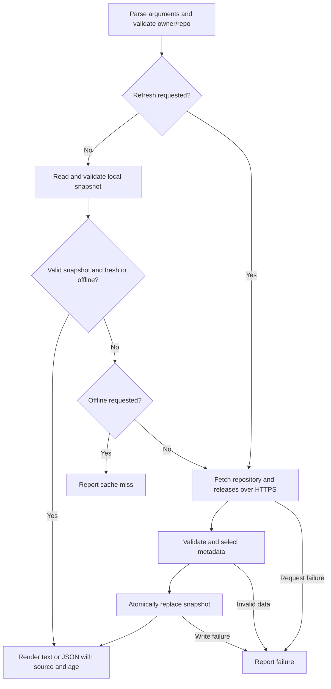

# GitHub Pulse

GitHub Pulse is a local CLI that summarizes a public GitHub repository's release and activity metadata. It runs on Python 3.10 or later using the standard library.

## Usage

Run from the project directory. The first command fetches a snapshot and the next two show how to reuse or replace it.

```sh
python github_pulse.py octocat/Hello-World
python github_pulse.py octocat/Hello-World --offline --json
python github_pulse.py octocat/Hello-World --refresh
```

The summary includes stars, forks, the combined open issue and pull request count, the default branch, archive status, and GitHub's last push and update timestamps. It displays published releases from GitHub's first page of up to ten results, sorted by publication time within that page. Prereleases are labeled. Empty release lists are valid.

Each successful fetch replaces one snapshot in a user-specific cache directory: LocalAppData/GitHubPulse/Cache on Windows, ~/Library/Caches/github-pulse on macOS, and XDG_CACHE_HOME/github-pulse or ~/.cache/github-pulse on Linux. Use --cache-dir PATH to choose a different directory; only use a directory you trust. Cached metadata is not cryptographically authenticated; use --refresh when you require a fresh API response. Normal runs reuse snapshots for 15 minutes. `--refresh` fetches immediately. `--offline` uses a valid snapshot of any age and marks stale data in the output. A failed fetch leaves the previous snapshot available for offline use.

Online runs use unauthenticated HTTPS requests to GitHub's public API and are subject to its rate limits. A renamed repository may require its current owner and name. API responses are parsed as data, and release notes are omitted from snapshots. Text and JSON outputs escape control characters in external strings.

The exit status is 0 on success, 1 for cache or fetch failures, and 2 for invalid arguments.

## Architecture



## Tests

```sh
python -B -m unittest discover -s tests -v
```

Tests use synthetic API responses and temporary cache directories. They require no network access.

## License and provenance

The project code, documentation, and synthetic test data were created for this repository and are offered under the MIT license. The copyright notice names the project contributors collectively. The project vendors no third-party code or data. Snapshots contain metadata supplied by GitHub and are outside the project's source license. [LICENSE](LICENSE) · [MIT license template](https://spdx.org/licenses/MIT.html)
